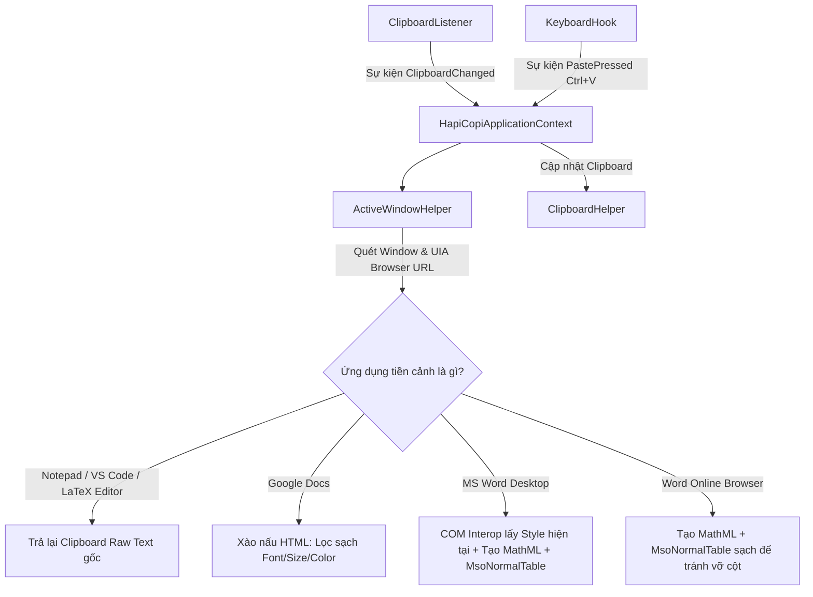

# BÁO CÁO KỸ THUẬT DỰ ÁN HAPICOPI
## Ứng dụng Tự động hóa Định dạng Văn bản & Công thức Toán từ AI sang MS Word và Google Docs

---

## 1. Giới thiệu chung (Overview)
**HapiCopi** là một tiện ích chạy ngầm (System Tray Application) trên hệ điều hành Windows, được thiết kế nhằm giải quyết triệt để các vấn đề vỡ định dạng khi người dùng sao chép nội dung văn bản (đặc biệt là nội dung chứa Markdown, bảng biểu, mã nguồn, và công thức toán học LaTeX) từ các chatbot AI (như ChatGPT, Gemini, Claude, Google Search AI Overview) để dán vào các phần mềm soạn thảo văn phòng như **Microsoft Word (Desktop & Online)** và **Google Docs**.

---

## 2. Kiến trúc hệ thống & Các thành phần chính (System Architecture)
Ứng dụng được xây dựng trên nền tảng **.NET 10.0 (Windows Forms & WPF Integration)**, cấu trúc tinh gọn với các thành phần chính sau:



### Chi tiết vai trò các file mã nguồn:
1. **[Program.cs](file:///c:/Users/ThienNLH3/Desktop/HapiCopi/Program.cs)**: 
   - Điểm khởi chạy của ứng dụng, khởi tạo cấu hình Windows Forms.
   - Thiết lập Icon khay hệ thống (`HC` màu xanh lục) kèm Context Menu (Tạm dừng / Thoát).
   - Phối hợp luồng sự kiện giữa Clipboard thay đổi và tổ hợp phím dán.
2. **[ClipboardListener.cs](file:///c:/Users/ThienNLH3/Desktop/HapiCopi/ClipboardListener.cs)**:
   - Đăng ký lắng nghe sự kiện thay đổi Clipboard của Windows thông qua Win32 API `AddClipboardFormatListener`.
   - Chạy trên một Handle cửa sổ ẩn để đảm bảo hiệu suất tốt nhất.
3. **[KeyboardHook.cs](file:///c:/Users/ThienNLH3/Desktop/HapiCopi/KeyboardHook.cs)**:
   - Sử dụng Win32 Hook bàn phím toàn hệ thống (`SetWindowsHookEx`) để bắt sự kiện người dùng nhấn tổ hợp phím **Ctrl + V** (Dán).
4. **[ActiveWindowHelper.cs](file:///c:/Users/ThienNLH3/Desktop/HapiCopi/ActiveWindowHelper.cs)**:
   - Xác định tiến trình (Process), Tên lớp (ClassName) và Tiêu đề cửa sổ (WindowTitle) đang ở tiền cảnh (Foreground Window).
   - **Tích hợp Windows UI Automation (UIA)** để quét nhanh URL trên thanh địa chỉ của các trình duyệt (Chrome, Edge, Firefox) trên một STA Thread riêng có timeout 300ms, giúp nhận diện chính xác các tab đang mở tài liệu Word Online hoặc Google Docs.
5. **[WordInterop.cs](file:///c:/Users/ThienNLH3/Desktop/HapiCopi/WordInterop.cs)**:
   - Sử dụng COM Dynamic Binding để truy vấn Microsoft Word Desktop đang chạy.
   - Lấy thông tin thời gian thực tại vị trí con trỏ (Font Name, Font Size, Line Spacing, Heading Level hiện tại) với cơ chế timeout 80ms để đảm bảo ứng dụng không bao giờ bị đơ nếu tiến trình Word gặp sự cố.
6. **[MarkdownToWordConverter.cs](file:///c:/Users/ThienNLH3/Desktop/HapiCopi/MarkdownToWordConverter.cs)**:
   - Nhân xử lý logic chính: Chuyển đổi Markdown sang HTML bằng thư viện `Markdig`.
   - Đồng hóa cấp độ Heading tự động (tịnh tiến level theo cấu trúc văn bản đích).
   - Parse các biểu thức công thức LaTeX sang Unicode (dành cho Docs/Text) hoặc MathML đứng (dành cho Word).
7. **[ClipboardHelper.cs](file:///c:/Users/ThienNLH3/Desktop/HapiCopi/ClipboardHelper.cs)**:
   - Thư viện đọc ghi dữ liệu Clipboard an toàn cho cả định dạng Text thuần và HTML chuẩn Windows (`CF_HTML`).
   - Đảm nhận cơ chế chống đệ quy (Anti-recursive loop).
8. **[MermaidRenderer.cs](file:///c:/Users/ThienNLH3/Desktop/HapiCopi/MermaidRenderer.cs)**:
   - Module kết xuất sơ đồ Mermaid ngầm sang Base64 Data URI thông qua API.
   - Sửa lỗi cú pháp và chuẩn hóa định dạng mã nguồn Mermaid.

---

## 3. Các giải pháp kỹ thuật nổi bật (Core Features & Problem Solving)

### 3.1. Nhận diện Word Online thông minh bằng UI Automation
- **Vấn đề**: Word Online chạy trong các tab trình duyệt thường đặt tiêu đề là tên tài liệu (ví dụ: `Báo cáo tài chính - Google Chrome`). Do không có từ khóa nhận diện cố định và Class Name chỉ là lớp trình duyệt chung (`Chrome_WidgetWin_1`), ứng dụng trước đây không thể biết người dùng đang dán vào Word Online, dẫn đến việc dán HTML thô từ AI làm vỡ cấu trúc cột của bảng biểu (cột co lại chỉ còn rộng 1 ký tự).
- **Giải pháp**: Tích hợp UI Automation quét các Edit Control chứa URL của trình duyệt. Nếu phát hiện tên miền là `sharepoint.com`, `office.com`, hoặc `office365.com` đi kèm các pattern tài liệu văn bản (`/w/`, `doc.aspx`, `word`), ứng dụng sẽ nhận định chính xác mục tiêu là Word Online và kích hoạt xử lý.

### 3.2. Bộ phân tích cú pháp HTML Tokenizer & Tránh treo ứng dụng (App Hang)
- **Vấn đề**: Sao chép các tài liệu kỹ thuật, bảng dữ liệu hoặc mã SQL có chứa dấu so sánh bé hơn `<` (như `WHERE age < 18` hoặc `x < y`) thường khiến các bộ phân tích HTML bằng Regex bị treo cứng (vòng lặp vô hạn do ký tự `<` không tạo thành thẻ đóng `>` hợp lệ).
- **Giải pháp**: Xây dựng bộ quét mã HTML dựa trên máy trạng thái (**State Machine Tokenizer**). Khi phát hiện ký tự `<` không đi kèm ký tự hợp lệ để tạo thẻ HTML, Parser sẽ tự động coi đó là ký tự text thường và tịnh tiến tiếp một cách an toàn.

### 3.3. Đồng hóa định dạng lai (Hybrid Formatting Logic)
HapiCopi nhận biết ứng dụng đích thời gian thực tại tích tắc người dùng bấm Ctrl+V để thay đổi nội dung clipboard cho phù hợp:
- **Dán vào MS Word Desktop**: Tự động kế thừa Font chữ (ví dụ: Times New Roman), cỡ chữ (ví dụ: 13pt) và giãn dòng (1.5) tại vị trí con trỏ của tài liệu Word hiện hành. Dịch công thức toán học sang MathML đồ họa.
- **Dán vào Word Online**: Lọc sạch style rác, giữ lại định dạng bảng biểu văn phòng tối giản (`MsoNormalTable` sạch, viền xám mờ `#cccccc`, padding hợp lý) để trình duyệt tự dàn cột đẹp đẽ. Dịch công thức toán học sang MathML đồ họa.
- **Dán vào Google Docs**: Lọc sạch toàn bộ các thuộc tính `font-family`, `font-size` và `color` để Google Docs tự động thừa kế 100% định dạng văn bản đích, tránh bị dính nền xám hoặc lệch font.
- **Dán vào các Editor chuyên biệt (VS Code, Notepad, Overleaf, Texmaker)**: Tự động phát hiện và khôi phục lại mã nguồn LaTeX/Markdown thô ban đầu để lập trình viên/người soạn thảo nhận được code gốc chính xác.

### 3.4. Bộ dịch công thức toán học LaTeX nâng cao
- **Trình biên dịch MathML nội dòng**: Dịch các công thức phân số đệ quy `\frac{A}{B}`, căn thức, các chỉ số trên dưới (`^`, `_`), các ký tự Hy Lạp (`\alpha` -> `α`, `\pi` -> `π`) thành cây thẻ MathML chuẩn dạng `<mfrac>`, `<msup>`, `<msub>`. Khi dán vào Word, Word tự động nhận diện MathML và biến nó thành đối tượng công thức đồ họa gốc (Equation) cực kỳ chuyên nghiệp.
- **Dịch Unicode sạch**: Chuyển các công thức toán học LaTeX thành dạng văn bản Unicode dễ đọc khi dán vào các ứng dụng không hỗ trợ MathML (như Google Docs hay Notepad), tránh hiện tượng hiện thị mã LaTeX thô như `\sin^2\alpha`.
- **Sửa lỗi ký hiệu nhân**: Nhận diện các lỗi sao chép ký hiệu từ web AI (như dấu `∈` hoặc `€` bị dịch sai từ dấu nhân) và tự động chuẩn hóa thành dấu chấm nhân trung học `·` (ví dụ: `3 · sin α`).

### 3.5. Tự động hóa vẽ sơ đồ Mermaid trực tiếp vào tài liệu
- **Vấn đề**: Bản vẽ sơ đồ Mermaid (`mermaid` code blocks) sinh ra từ AI chỉ là các dòng code chữ thô. Để lấy ảnh chèn vào Word/Docs, người dùng bắt buộc phải mở các web trung gian, paste code, tải ảnh về máy rồi chèn thủ công.
- **Giải pháp**: 
  - Thiết lập tiến trình lắng nghe Clipboard bất đồng bộ ngầm. Khi phát hiện mã ````mermaid````, HapiCopi tự động mã hóa Base64 và gửi yêu cầu HTTPS đến máy chủ Mermaid để tải về tệp ảnh PNG ở background.
  - Ảnh PNG được chuyển đổi thành định dạng Base64 Data URI (`data:image/png;base64,...`) và bọc trực tiếp vào thẻ `` trong tài liệu HTML của clipboard. Khi dán vào Word/Google Docs, phần mềm tự giải mã và hiển thị sơ đồ trực quan hoàn chỉnh.
  - **Tự động sửa lỗi cú pháp**: Module tự động lọc sạch các nhãn chứa ngoặc đơn lỗi của AI (ví dụ: `A[Bắt đầu (AI)]` $\rightarrow$ `A["Bắt đầu (AI)"]`), thay thế các dấu nháy cong tiếng Việt (`“`, `”`) thành nháy thẳng, và sửa chữa các mũi tên vẽ sai cấu trúc (`==>>` $\rightarrow$ `==>`), đảm bảo biểu đồ luôn hiển thị thành công.

---

## 4. Hướng dẫn sử dụng & Kiểm thử (Verification & Test Cases)

### 4.1. Hướng dẫn chạy ứng dụng
1. Mở Terminal tại thư mục gốc dự án.
2. Chạy lệnh: `dotnet run` (hoặc chạy trực tiếp file `HapiCopi.exe` trong thư mục `bin\Debug\net10.0-windows`).
3. Ứng dụng sẽ xuất hiện dưới dạng một Icon khay hệ thống hình tròn xanh lục có chữ **HC**.

### 4.2. Các kịch bản kiểm thử chuẩn

| Kịch bản | Dữ liệu kiểm thử (Copy) | Đích đến (Paste) | Kết quả mong đợi (Đạt chuẩn) |
|---|---|---|---|
| **1. MS Word Desktop** | Đoạn Markdown có tiêu đề `# Tiêu đề` và danh sách `- Yếu tố 1` | Microsoft Word đang mở (đang cấu hình Times New Roman, 13pt) | Văn bản tự động định dạng chuẩn theo Times New Roman 13pt. Tiêu đề tự động map thành Heading tương ứng, bullet points chuẩn của Word. |
| **2. Google Docs** | Văn bản Markdown từ AI | Google Docs trên Chrome/Edge (đang dùng Arial 11pt) | Văn bản hiển thị sạch sẽ, tự động ăn theo định dạng Arial 11pt, không bị viền/nền xám. |
| **3. Word Online (Bảng biểu)** | Bảng biểu Markdown hoặc HTML từ ChatGPT/Gemini | Word Online trên Chrome/Edge | Bảng hiển thị cân đối, viền mỏng xám mờ `#cccccc`, tự động giãn cột theo chiều rộng trang (không bị vỡ chữ/co cụm cột). |
| **4. Word Online (Toán học)** | Biểu thức: `\sin ^{2}\alpha +\cos ^{2}\alpha =1` hoặc `\frac{a}{b}` | Word Online trên Chrome/Edge | Tự động chuyển đổi thành đối tượng Equation gốc của Word với phân số thẳng đứng đồ họa. |
| **5. VS Code / Notepad** | Đoạn văn bản Markdown | VS Code / Notepad | Khôi phục và dán ra văn bản Markdown thô ban đầu (không bị dịch mất các ký hiệu Markdown hay công thức). |
| **6. Sơ đồ Mermaid (Tự sửa lỗi & Chèn ảnh)** | Khối mã ````mermaid\nflowchart TD\n  A[Bắt đầu (AI)] --> B(Kết quả (Thành công))\n```` | MS Word (Desktop & Online) hoặc Google Docs | Tự động cân bằng ngoặc của nhãn thành `A["Bắt đầu (AI)"]` và `B("Kết quả (Thành công)")`, kết xuất ngầm sang ảnh PNG và dán trực tiếp biểu đồ dưới dạng hình ảnh vào tài liệu. |

---

## 5. Kết luận
HapiCopi là giải pháp đột phá, giải quyết triệt để vấn đề chuyển giao định dạng văn bản từ AI sang môi trường soạn thảo văn phòng. Với bộ phân tích Tokenizer an toàn, cơ chế UIA quét URL trình duyệt thời gian thực, và bộ biên dịch LaTeX sang MathML/Unicode thông minh, ứng dụng mang lại trải nghiệm làm việc mượt mà, chuyên nghiệp và tiết kiệm tối đa thời gian cho người dùng.
