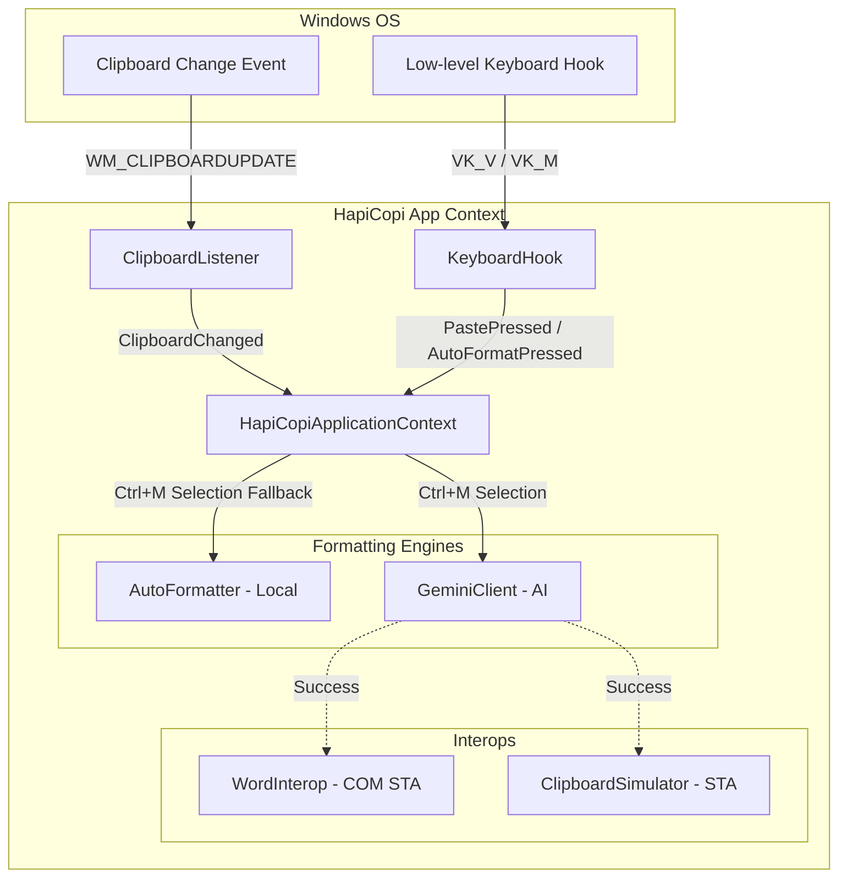
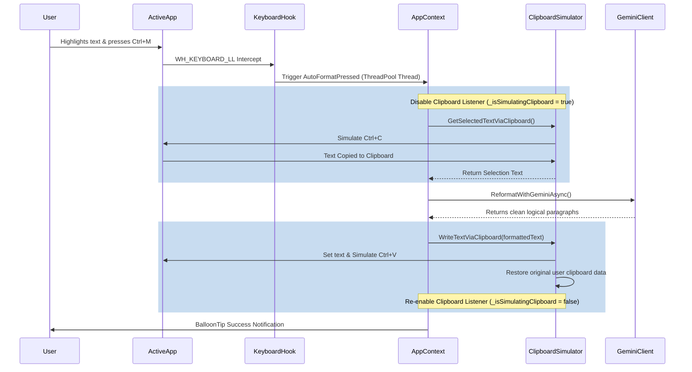

# HapiCopi: Architectural Analysis

This document describes the architectural layout of HapiCopi, detailing the flow of data, event hooks, threading boundaries, and how simulated formatting interacts with the Windows ecosystem.

---

## 1. High-Level Architecture Overview

HapiCopi is a Windows Forms background utility running in a headless `ApplicationContext`. It consists of three core systems:
1. **Clipboard Listener (`ClipboardListener.cs`)**: Listens to system-wide clipboard changes via Windows API message loops.
2. **Keyboard Hook (`KeyboardHook.cs`)**: Listens to system-wide keyboard events using a low-level keyboard hook (`WH_KEYBOARD_LL`).
3. **Format Engine (`MarkdownToWordConverter.cs`, `AutoFormatter.cs`, `GeminiClient.cs`)**: Translates Markdown/LaTeX syntax or runs smart paragraphing heuristics/AI calls.



---

## 2. Core Flows

### Flow A: Automatic Clipboard Paste Interception (Original Feature)
1. **Copy Action**: The user copies text from a source (e.g., ChatGPT, browser, text file).
2. **Clipboard Update**: Windows fires `WM_CLIPBOARDUPDATE`. `ClipboardListener` receives it and trigg

ers `OnClipboardChanged` in `Program.cs`.
3. **Validation**: `ProcessClipboard` runs. It queries the clipboard. If it detects Markdown or AI HTML structure (`IsMarkdownOrAiHtml` returns `true`):
   - It formats the text into Office-compatible HTML.
   - It writes the formatted HTML and plain text back to the clipboard.
   - It marks this new clipboard object with a special marker format (`HapiCopiProcessed`) to prevent infinite recursion.
   - It sets a context variable `_lastWasProcessed = true` and caches the raw text.
4. **Paste Action**: The user presses `Ctrl + V` in a targeted application.
5. **Key Hook Interception**: `KeyboardHook` captures the key and fires `PastePressed` asynchronously.
6. **Active App Analysis**: The app inspects the active foreground window class via `ActiveWindowHelper`.
   - **Google Docs / Word Online**: We clean the HTML to strip hardcoded fonts and sizes (inheriting the cursor's default style), set it to the clipboard, and trigger the paste.
   - **MS Word**: We use COM Interop (`WordInterop`) to get document details and set compatible formatting.
   - **VS Code / Notepad**: We restore the original raw Markdown text to the clipboard so formatting markers are not pasted into plain text editors.

---

## 3. Threading Boundaries (STA vs. MTA)

Windows Clipboard APIs and COM Interop have strict apartment-state constraints:

| Component | Thread State | Reason |
| :--- | :--- | :--- |
| **Main Loop (`Program.cs`)** | **STA** (Single Threaded Apartment) | WinForms forms and tray icons must run in STA to support OLE/COM. |
| **Clipboard Listener** | **STA** | Triggered by a hidden message-only WinForms Form handle, running on the main STA thread. |
| **Keyboard Hook Callback** | **MTA** (Multi Threaded Apartment) | Keyboard hook events are invoked on a background thread pool task (`Task.Run`) to prevent blocking the OS input queue. |

### The Threading Conflict
Because the keyboard hook triggers on a **ThreadPool thread (MTA)**, directly invoking `Clipboard` read/write APIs throws a silent `ThreadStateException`. 

To fix this, we updated [ClipboardHelper.cs](file:///c:/Users/ThienNLH3/Desktop/HapiCopi/ClipboardHelper.cs) to automatically spawn a temporary STA thread whenever it is called from an MTA context:
```csharp
if (Thread.CurrentThread.GetApartmentState() != ApartmentState.STA)
{
    // Spawn a temporary STA thread to safely interact with Clipboard
    var thread = new Thread(() => result = ClipboardAction());
    thread.SetApartmentState(ApartmentState.STA);
    thread.Start();
    thread.Join();
}
```

---

## 4. Smart Selection Formatting Flow (Ctrl + M)

When the user highlights text and presses `Ctrl + M`:



---

## 5. Potential Failures & Debugging Steps

If pasting or `Ctrl + M` is not acting as expected, check the following in `debug.log`:

1. **`IsMarkdownOrAiHtml` returning `False`**:
   The copied text must match Markdown syntax patterns (headers, bullet points, asterisks, math formulas) or contain prose/markdown HTML classes in the browser. Normal plain text will not trigger formatting during standard copy-paste.
2. **No `Phát hiện phím tắt Ctrl+M` Log**:
   If pressing `Ctrl + M` prints nothing, either:
   - The focus is on a privileged window (e.g. running as Administrator while HapiCopi runs as normal user), preventing hook capture.
   - The hook was unloaded by Windows (e.g. if the system was lagging). Restarting the application re-registers the hook.
