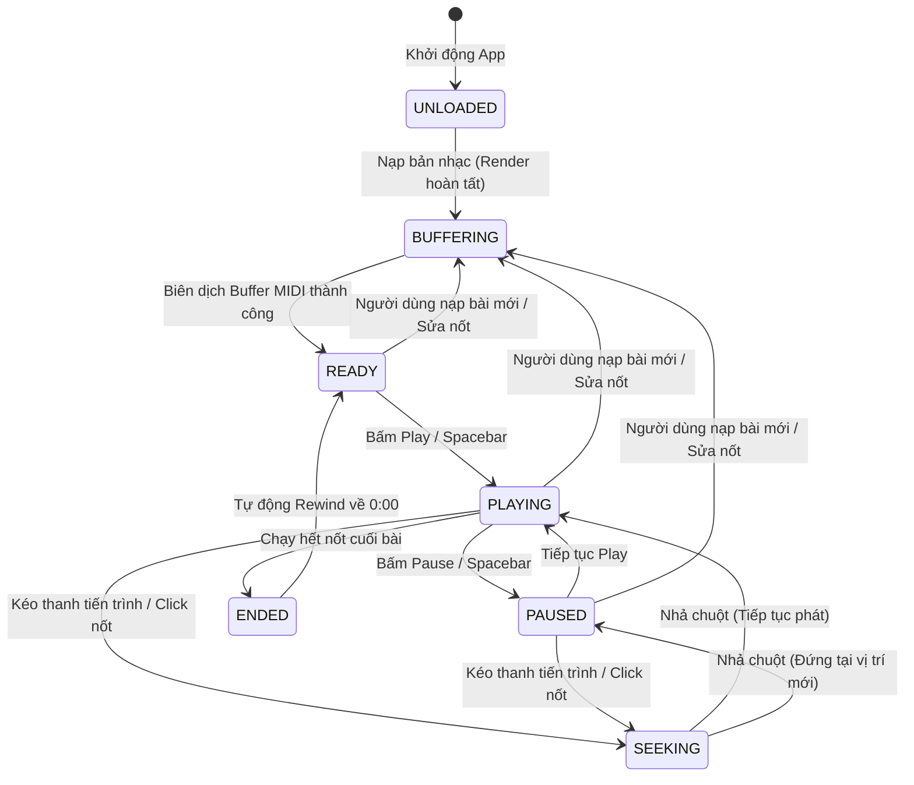
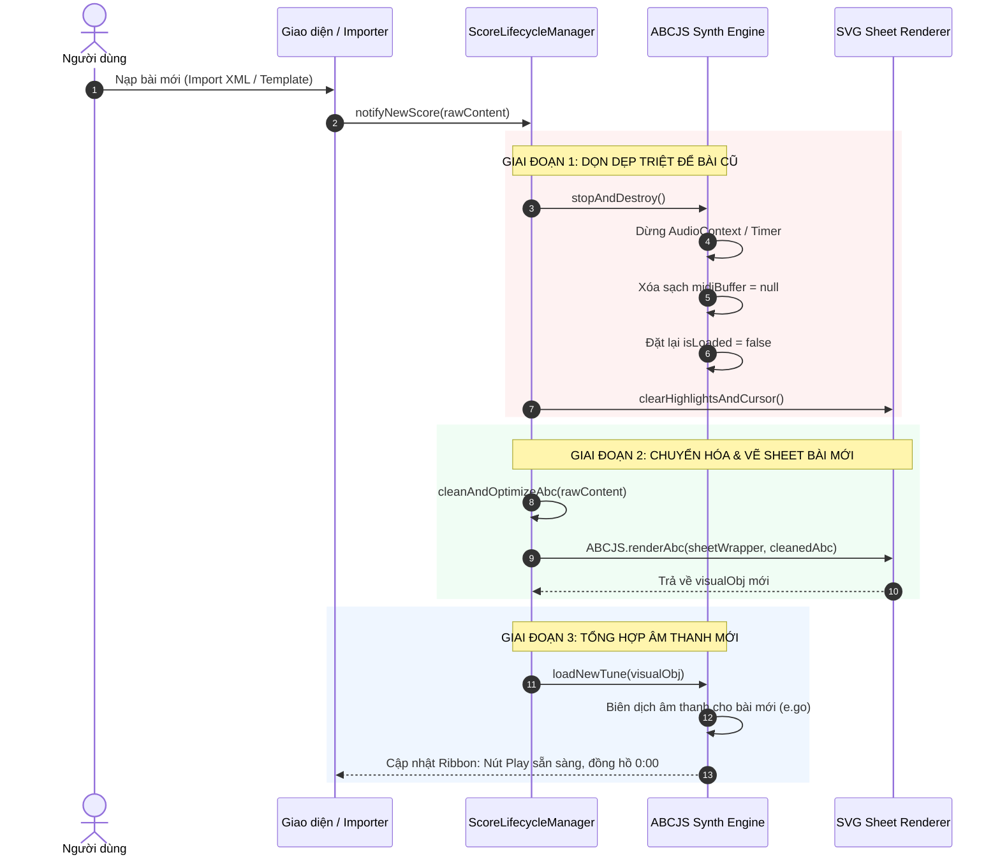
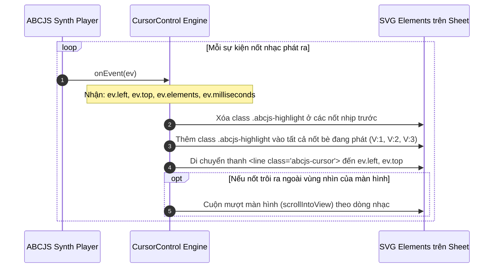

# TÀI LIỆU THIẾT KẾ VÀ ĐẶC TẢ LUỒNG NGHIỆP VỤ: ĐỘNG CƠ ÂM THANH & ĐỒNG BỘ BẢN NHẠC
**HapiCopi Studio - Professional MuseScore-Grade Music Engine**

---

## 1. MỤC TIÊU & NGUYÊN TẮC THIẾT KẾ (DESIGN PRINCIPLES)

Để chấm dứt hoàn toàn tình trạng **"code chắp vá"** (sửa chỗ này làm hỏng chỗ khác, âm thanh phát bài cũ, mất bè, trôi nhịp), toàn bộ tính năng âm thanh được chuẩn hóa theo các nguyên tắc kỹ thuật sau:

1. **Đơn quyền sở hữu vòng đời (Single Source of Lifecycle Truth):**
   Mọi hành động nạp bài mới, gõ nốt, đổi bài mẫu, đổi nhịp độ đều phải đi qua **một điểm quản lý vòng đời duy nhất** (`ScoreLifecycleManager`), không viết code rải rác ở từng nút bấm hay từng hàm riêng lẻ.
2. **Nguyên tắc phân tách Đồ họa (View) và Âm thanh (Audio Model):**
   - Đồ họa (SVG Sheet): Phản hồi tức thì với tốc độ 60 FPS khi người dùng tương tác.
   - Âm thanh (Synth Engine): Được quản lý theo hàng đợi và lập lịch (debounced buffer compilation), không bao giờ được phép chặn luồng giao diện chính (Main Thread).
3. **Quy tắc vô hiệu hóa bộ đệm tuyệt đối (Strict Cache Invalidation):**
   Bất cứ khi nào cấu trúc nốt nhạc thay đổi, bộ đệm âm thanh cũ **bắt buộc phải bị tiêu hủy hoàn toàn**. Không phụ thuộc vào các cờ cache nội bộ của thư viện bên thứ ba.
4. **Đa bè đồng thời (True Polyphony):**
   Phát âm thanh chuẩn xác đồng thời tất cả các bè: Bè 1 (Khóa Sol - Giai điệu), Bè 2 & Bè 3 (Khóa Fa - Bass & Hợp âm đệm), Grand Staff 2 tay, các hợp âm chùm, liên ba `(3:2:2` và liên sáu `(6:4:5`.

---

## 2. MÔ HÌNH MÁY TRẠNG THÁI ÂM THANH (FINITE STATE MACHINE)



### Chi tiết các trạng thái:
| Trạng thái | Nút Play trên Ribbon | Đồng hồ | Vạch con trỏ & Highlight | Bộ đệm âm thanh (`midiBuffer`) |
| :--- | :--- | :--- | :--- | :--- |
| **`UNLOADED`** | Disabled | `--:--` | Ẩn | `null` |
| **`BUFFERING`** | Biểu tượng Loading quay | Giữ nguyên | Ẩn vạch con trỏ | Đang biên dịch trong nền |
| **`READY`** | Biểu tượng Play (Sẵn sàng) | `0:00` | Ẩn con trỏ, xóa highlight | Đã sẵn sàng phát |
| **`PLAYING`** | Biểu tượng Pause (Đang chạy) | Đếm thực | Vạch xanh chạy theo nhịp, highlight nốt | Đang stream ra AudioContext |
| **`PAUSED`** | Biểu tượng Play | Dừng tại $T$ | Đứng yên tại vị trí tạm dừng | Giữ nguyên vị trí $T$ |
| **`SEEKING`** | Giữ nguyên trạng thái trước | Nhảy theo chuột | Kim nhảy tức thì theo con trỏ chuột | Cập nhật vị trí phát mới |
| **`ENDED`** | Chuyển về Play | `0:00` | Tự xóa kim & highlight | Tua về đầu |

---

## 3. CHI TIẾT CÁC LUỒNG NGHIỆP VỤ (BUSINESS FLOWS)

---

### LUỒNG 1: KHỞI TẠO HỆ THỐNG & KÍCH HOẠT WEB AUDIO (BOOTSTRAP & UNLOCK)

- **Mục tiêu:** Vượt qua rào cản Autoplay Policy của trình duyệt một cách an toàn mà không làm nghẽn ứng dụng.
- **Tác nhân kích hoạt:** Ứng dụng khởi động xong và người dùng có bất kỳ tương tác đầu tiên nào (click chuột, gõ phím, bấm nút).

#### Trình tự thực thi:
1. `WebViewResources/abceditor.html` tải xong các script cốt lõi (`jquery`, `jszip`, `xml2abc`, `abcjs-basic-min.js`).
2. Khởi tạo đối tượng `CursorControl` phụ trách việc vẽ kim nhạc và highlight SVG.
3. Khởi tạo `SynthController` và liên kết với vùng chứa DOM `#audio` trên thanh Ribbon.
4. Lắng nghe sự kiện người dùng đầu tiên (`pointerdown`, `keydown`) để gọi `AudioContext.resume()`. Nếu trạng thái là `suspended`, chuyển an toàn sang `running`.

---

### LUỒNG 2: NẠP BẢN NHẠC MỚI (NEW SCORE INGESTION FLOW)

- **Mục tiêu:** Đảm bảo khi mở bất kỳ bản nhạc nào mới, **toàn bộ âm thanh và hình ảnh của bài cũ phải bị xóa sạch 100% trước khi nạp bài mới**.
- **Tác nhân kích hoạt:**
  - Người dùng bấm **Mở Sheet...** chọn file `.xml`, `.musicxml`, `.mxl`, `.abc`, `.txt`.
  - Người dùng chọn bài từ menu **Bài mẫu**.
  - Người dùng kéo-thả file vào màn hình.
  - Người dùng dán (paste) một đoạn mã nhạc lớn vào ô soạn thảo.



#### Quy tắc nghiệp vụ bắt buộc:
1. **Dập tắt âm thanh cũ tức thì:** Nếu bài cũ đang phát, hàm hủy phải dừng ngay lập tức mọi âm thanh đang vang, không để hiện tượng 2 bài phát chồng lên nhau.
2. **Hủy bộ đệm cũ:** Gán `synthControl.isLoaded = false` và `synthControl.midiBuffer = null`. Không cho phép tái sử dụng buffer của bài trước.
3. **Cập nhật thông số tiêu đề:** Đọc lại các thẻ `M:` (nhịp), `K:` (giọng), `Q:` (tốc độ) của bài mới lên các ô chọn trên thanh công cụ.

---

### LUỒNG 3: SOẠN THẢO NỐT LIÊN TỤC & ĐỆM ĐỘNG (REAL-TIME EDITING & DEBOUNCED BUFFERING)

- **Mục tiêu:** Khi người dùng đang nhập nốt liên tục (bằng bàn phím máy tính 10 ngón, click chuột, phím đàn ảo, hoặc đàn MIDI cắm ngoài), giao diện phải mượt 60 FPS, không bị giật lag vì nạp audio liên tục.
- **Tác nhân kích hoạt:**
  - Nhấn phím `A-B-C-D-E-F-G` hoặc `1-5` (trường độ).
  - Nhấn phím đàn Piano ảo trên ngăn kéo hoặc đánh trên đàn MIDI USB.
  - Thêm dấu chấm dôi `.`, dấu thăng `+`, dấu giáng `-`, dấu lặng `0`.
  - Thay đổi thanh trượt tốc độ BPM (`bpmSlider`).
  - Chức năng Undo (`Ctrl+Z` hoặc `Backspace`).

#### Cơ chế hoạt động (Two-Tier Architecture):

```
[ Thao tác nhập nốt của người dùng ]
               │
               ▼
┌──────────────────────────────────────────────┐
│ TẦNG 1: HIỂN THỊ TỨC THÌ (Zero Delay - 60FPS)│
│ - Cập nhật ô mã ABC                          │
│ - Tự động vạch nhịp (Auto-Barring)           │
│ - ABCJS.renderAbc() vẽ ngay nốt lên khuông   │
│ - Phát tiếng gõ nốt đơn lẻ (Preview Tone)    │
└──────────────────────────────────────────────┘
               │
               ▼
┌──────────────────────────────────────────────┐
│ TẦNG 2: BẬP BÊNH LẬP LỊCH ÂM THANH (Debounce)│
│ - Hủy Timer chờ trước đó                     │
│ - Đặt Timer mới: 300ms                       │
│ - Người dùng gõ tiếp? -> Lại gia hạn 300ms   │
│ - Người dùng ngừng gõ >= 300ms?              │
│      ==> GỌI BIÊN DỊCH BỘ ĐỆM ÂM THANH MỚI   │
└──────────────────────────────────────────────┘
```

#### Quy tắc nghiệp vụ:
- Nếu bản nhạc đang ở trạng thái `PLAYING` mà người dùng bấm sửa nốt: Hệ thống tự động chuyển về `PAUSED`, hủy kim quét cũ, và sau khi ngừng sửa 300ms sẽ chuẩn bị lại bộ đệm cho trạng thái `READY`.

---

### LUỒNG 4: PHÁT / TẠM DỪNG BẢN NHẠC (PLAY / PAUSE / RESUME)

- **Mục tiêu:** Phát đầy đủ tất cả các bè với tốc độ chuẩn xác, cho phép tạm dừng và phát tiếp mượt mà.
- **Tác nhân kích hoạt:** Bấm nút **Phát** trên thanh Ribbon hoặc nhấn **phím Cách (Spacebar)**.

#### Trình tự thực thi:
1. **Kiểm tra trạng thái:**
   - Nếu đang `PLAYING`:
     - Chuyển nút về biểu tượng tam giác Play.
     - Gọi lệnh `synthControl.pause()`.
     - Giữ nguyên vị trí kim con trỏ trên khuông nhạc.
     - Đồng hồ thời gian dừng tại giây hiện tại.
     - Chuyển máy trạng thái sang `PAUSED`.
   - Nếu đang `READY` hoặc `PAUSED`:
     - Kiểm tra nếu `isLoaded === false`: Chờ bộ đệm biên dịch xong (`e.go()`).
     - Chuyển nút sang biểu tượng hai gạch Pause.
     - Gọi lệnh `synthControl.play()`.
     - Kích hoạt AudioContext, phát âm thanh ra loa.
     - Kích hoạt `cursorControl.onStart()`.
     - Chuyển máy trạng thái sang `PLAYING`.

---

### LUỒNG 5: ĐỒNG BỘ CON TRỎ & HIGHLIGHT THỜI GIAN THỰC (SCORE SYNCHRONIZATION)

- **Mục tiêu:** Khi âm thanh phát đến nốt nào, mắt người dùng phải nhìn thấy nốt đó sáng lên và có kim dẫn nhịp đi qua, áp dụng cho cả 2 tay (khóa Sol và khóa Fa).



#### Quy tắc nghiệp vụ:
1. **Xử lý hợp âm & nhiều bè:** Trong một thời điểm, nếu có hợp âm 3 nốt hoặc bè 2 cùng đánh nốt trầm, `ev.elements` chứa mảng phần tử của tất cả các nốt đó. Hệ thống phải highlight **đồng loạt tất cả các nốt cùng vang**, không được chỉ highlight 1 nốt duy nhất.
2. **Dọn dẹp khi dừng hoặc kết thúc:** Khi bài dừng hoặc hết bài, toàn bộ class `.abcjs-highlight` và vạch kim `.abcjs-cursor` phải được xóa sạch, trả bản nhạc về trạng thái tĩnh sạch sẽ.

---

### LUỒNG 6: TUA & NHẢY Ô NHỊP (SEEKING & SCRUBBING)

- **Mục tiêu:** Cho phép người dùng tua bài đến bất kỳ đoạn nào bằng cách kéo thanh tiến trình hoặc click chuột trực tiếp vào một nốt nhạc trên khuông.
- **Tác nhân kích hoạt:**
  - Click hoặc kéo con chạy trên thanh Ribbon (`.abcjs-midi-progress-background`).
  - Click chuột vào một nốt nhạc bất kỳ trên sheet SVG (`clickListener`).

#### Trình tự thực thi:
1. Xác định thời điểm mục tiêu $T_{target}$ hoặc vị trí nốt được click.
2. Cập nhật thanh tiến trình hiển thị vị trí tương ứng.
3. Nếu đang phát (`PLAYING`):
   - Chuyển con trỏ âm thanh đến $T_{target}$.
   - Cập nhật ngay lập tức vị trí vạch kim SVG đến vị trí nốt đó.
   - Âm thanh tiếp tục phát liền mạch từ $T_{target}$, không bị vấp đĩa.
4. Nếu đang dừng (`PAUSED` hoặc `READY`):
   - Cập nhật đồng hồ và vị trí kim đến điểm được chọn để sẵn sàng bấm Play là phát từ đó.

---

### LUỒNG 7: KẾT THÚC BẢN NHẠC (PLAYBACK COMPLETION)

- **Mục tiêu:** Khi bài nhạc phát xong nốt cuối cùng, hệ thống tự động tái lập trạng thái ban đầu một cách gọn gàng.
- **Tác nhân kích hoạt:** Bộ đếm thời gian của bài đạt tổng thời lượng `totalDuration`.

#### Trình tự thực thi:
1. ABCJS gọi callback `cursorControl.onFinished()`.
2. Xóa toàn bộ highlight nốt nhạc và ẩn thanh kim quét.
3. Chuyển nút điều khiển trên Ribbon từ biểu tượng Pause về biểu tượng Play.
4. Đặt lại đồng hồ thời gian về `0:00`.
5. Đưa vị trí phát của bộ đệm về điểm bắt đầu ($T = 0$).
6. Chuyển trạng thái máy về `READY`.

---

## 4. BẢNG MA TRẬN XỬ LÝ TRƯỜNG HỢP BIÊN (EDGE CASES MATRIX)

| Trường hợp biên (Edge Case) | Nguy cơ tiềm ẩn nếu "code chắp vá" | Quy chuẩn xử lý bắt buộc (Standard Solution) |
| :--- | :--- | :--- |
| **1. Đang phát bài A thì người dùng bấm nạp bài B** | Hai bài phát đè lên nhau; hoặc mắt thấy bài B nhưng tai nghe bài A. | Gọi hàm `stopAndDestroy()` dừng triệt để bài A, hủy toàn bộ timer, xóa `midiBuffer = null`, `isLoaded = false` trước khi vẽ bài B. |
| **2. Người dùng gõ nốt liên tục tốc độ cao (10 ngón)** | Web Audio biên dịch liên tục làm đơ trình duyệt, vỡ tiếng, drop khung hình. | Cơ chế Debounce 300ms: Giao diện vẽ nốt 60 FPS tức thì; âm thanh chỉ tổng hợp lại khi người dùng ngừng gõ đủ 300ms. |
| **3. Bản nhạc chỉ có nốt lặng hoặc bị lỗi cú pháp** | Bấm Play bị văng lỗi Javascript màn hình trắng. | Kiểm tra `warnings` và số lượng event trước khi nạp vào synth. Nếu rỗng, hiển thị toast thông báo và vô hiệu hóa nút Play an toàn. |
| **4. Bản nhạc phức tạp có nhiều bè (V:1, V:2, V:3) và dấu hóa bất thường** | Parser tay tự chế sẽ bỏ sót bè đệm tay trái hoặc phát sai nốt thăng/giáng. | Sử dụng 100% engine chuẩn của thư viện `ABCJS.synth` hỗ trợ toàn diện Polyphonic, không viết regex thủ công để tách nốt. |
| **5. Bản nhạc quá dài (nhiều trang cuộn dọc)** | Con trỏ kim chạy khuất khỏi màn hình, người dùng không theo dõi được. | Trong sự kiện `onEvent`, kiểm tra tọa độ Y của nốt. Nếu vượt ngưỡng nhìn, tự động cuộn khung nhìn mượt mà (`behavior: 'smooth'`). |
| **6. Nhấn phím Spacebar khi đang gõ chữ trong ô mã ABC** | Bị nhảy phát nhạc thay vì gõ dấu cách văn bản. | Kiểm tra `document.activeElement === input`. Nếu đang focus trong ô soạn thảo, Spacebar là gõ chữ bình thường; chỉ khi focus ngoài khuông nhạc mới kích hoạt Play/Pause. |

---

## 5. BỘ QUY TẮC BẤT BIẾN (ARCHITECTURAL GUARD RAILS)

Để đảm bảo chất lượng code chuẩn MuseScore từ nay về sau:

1. **Tuyệt đối không viết thêm các hàm phân tích nốt thủ công (No custom regex audio parsers):** Mọi tác vụ liên quan đến âm thanh đều phải do hệ thống âm thanh chuẩn xử lý để đảm bảo toàn vẹn đa bè và nhịp phách.
2. **Mọi thay đổi bản nhạc phải đi qua hàm trung tâm `loadAbcText`:** Không được tự ý gán `input.value` lẻ tẻ ở các nút bấm mà không gọi chu trình dọn cache âm thanh.
3. **Mỗi phiên nạp bài là một phiên làm sạch bộ nhớ (Idempotent Lifecycle):** Đảm bảo tính bất biến: *Một bản nhạc mới được nạp vào thì bộ đệm âm thanh phát ra bắt buộc phải là của chính bản nhạc đó.*
4. **Nguyên tắc nhất quán tuyệt đối (Consistency is the Base):**
   - **Tối kỵ "chuột một đằng, nốt một nẻo":** Tuyệt đối cấm hành vi chuột click ở đầu trang mà nốt lại âm thầm bị chèn vào cuối bài (`|]`).
   - Click chuột vào khuông nhạc là để **Chọn nốt / Đặt kim phát nhạc** tại đúng vị trí đó.
   - Khi gõ nốt, nốt phải rơi chính xác tại **vị trí con trỏ Caret đang chọn**.
   - Phải đảm bảo đồng bộ 4 chiều: *Mắt thấy nốt nào $\leftrightarrow$ Chuột trỏ nốt đó $\leftrightarrow$ Ký tự mã ABC ở dòng đó $\leftrightarrow$ Tai nghe âm thanh của nốt đó.*
5. **Chuẩn mực thiết kế đồng bộ đa phân hệ (Cross-Session Consistency):**
   - HapiCopi gồm nhiều phân hệ (Toán học `matheditor.html`, Bản nhạc `abceditor.html`, Sơ đồ `index.html`, Khay hệ thống). Bất kỳ sự lệch chuẩn nào giữa các cửa sổ đều khiến sản phẩm bị lôm côm, chắp vá.
   - Bắt buộc đồng bộ: Bảng màu thương hiệu xanh lá Emerald (`#059669` / `#10b981` đồng bộ với Logo "HC" trên taskbar và khay hệ thống, tuyệt đối không dùng xanh dương `#2563eb`), độ cao Header (`44px`), độ cao nút (`28px`), border-radius (`5px`), phím tắt (`Ctrl+Enter` sao chép ảnh 300 DPI, `Ctrl+B` toàn màn hình Zen mode).
   - 100% icon là SVG Vector Line-Art chuẩn (`0 0 24 24`, stroke `1.75px`), cấm dùng emoji màu mè và text symbols tự gõ.
