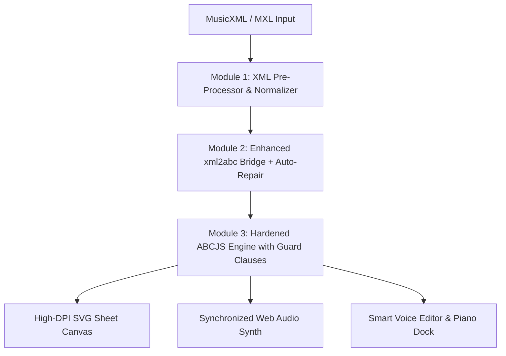

# Kế hoạch Nâng cấp Toàn diện Music Engine HapiCopi Studio (Chuẩn MuseScore)

> **Mục tiêu**: Xóa bỏ vĩnh viễn các lỗi import MusicXML, lỗi lệch nhịp Synth, crash `undefined` khi render, và nâng tầm trải nghiệm soạn thảo nhạc của HapiCopi đạt độ ổn định, chính xác và mượt mà tương đương MuseScore.
> 
> **TRIẾT LÝ THIẾT KẾ BẤT BIẾN: GỌN - SẠCH - NHẸ (MINIMAL & DISTRACTION-FREE)**  
> *Các phần mềm chuyên nghiệp như MuseScore hay Sibelius thường mắc một nhược điểm chí mạng: giao diện quá rườm rà, hàng trăm nút bấm và menu đa tầng đặc nghẹt gây rối mắt. HapiCopi Studio kiên quyết đi theo hướng ngược lại:*
> 1. **Giao diện ngữ cảnh (Contextual Floating UI)**: Chỉ hiển thị công cụ khi cần, không bày la liệt mọi thứ ra màn hình.
> 2. **Tối ưu không gian cho tờ Sheet (Zen Score Canvas)**: Bản nhạc là trung tâm, thanh công cụ dưới đáy (Dock) mỏng nhẹ, có thể thu gọn 1 chạm (`▾ Thu gọn`).
> 3. **Phím tắt ngầm thông minh**: Người dùng gõ phím vật lý tự nhiên mà không cần phải nhồi nhét hàng đống nút icon phức tạp.
> 4. **Giữ vững bản sắc HapiCopi**: Khởi động tức thì, tiêu thụ RAM cực thấp, mượt mà và trực quan ngay từ cái nhìn đầu tiên.

---

## 1. Phân tích Nguyên nhân Gốc rễ (Root Cause Analysis)

Hiện tại, HapiCopi sử dụng pipeline:
$$\text{File MusicXML (.mxl/.xml)} \xrightarrow{\text{xml2abc.js}} \text{Mã ABC Notation} \xrightarrow{\text{ABCJS Engine}} \text{SVG Sheet Music + Web Audio Synth}$$

Khi gặp các bản nhạc piano cổ điển hoặc chuyển soạn phức tạp thực tế xuất từ MuseScore/Sibelius, hệ thống gặp 4 điểm nghẽn nghiêm trọng:
1. **Lệch pha Voice & Measure Matrix (Voice Desync)**:
   - Các file MusicXML piano thường có 2 khuông (Treble & Bass), nhưng chia thành nhiều voice (Voice 1, Voice 2, Voice 3...).
   - `xml2abc` khi xuất ra thường để Voice 3 chỉ xuất hiện ở một số ô nhịp cuối (như trong bài *Good Night*), dẫn đến các system line thiếu mảng voice tương ứng.
   - `ABCJS` duyệt qua `e[t].voices[r]` mà không kiểm tra tồn tại $\rightarrow$ Gây lỗi vỡ màn hình: `Cannot read properties of undefined (reading 'length')` tại `containsLyrics` và `createABCVoice`.
2. **Ngắt dòng cưỡng bức đơn lẻ (`$`) làm gãy khuông**:
   - Thẻ `<print new-system="yes"/>` trong MusicXML chỉ xuất hiện ở Voice 1. Khi dịch sang ABC, chỉ Voice 1 có dấu `$`, còn Voice 2 và Voice 3 không có $\rightarrow$ Vạch nhịp 2 tay bị so le, méo mó.
3. **Ký hiệu kỹ thuật không tương thích**:
   - Dấu pedal liên tục `!ped!`, `!ped-up!`, `!arpeggio!`, `slur` bị gán class CSS `.abcjs-highlight` gây loang lổ vết xanh.
   - Nốt hoa mỹ acciaccatura sinh ra dạng `{/G}` chứa dấu `/` khiến ABCJS báo lỗi cú pháp.
4. **Desync âm thanh giữa 2 tay**:
   - Các ô nhịp nghỉ của một tay không được điền nốt lặng đầy đủ làm bè bass chạy trước bè treble hoặc ngược lại.

---

## 2. Kiến trúc Giải pháp 4 Giai đoạn (MuseScore-Grade Architecture)

### Giai đoạn 1: Chuẩn hóa Cấu trúc MusicXML (XML Pre-Processor)
- **Tách và làm sạch XML**:
  - Tự động bóc tách file nén `.mxl` qua `JSZip`, loại bỏ sạch DOCTYPE và các namespace gây xung đột bộ phân tích DOM.
- **Cân bằng Ma trận Thời lượng (Measure Duration Balancer)**:
  - Quét qua từng `<measure>` của từng `<part>`. Đảm bảo tổng số `duration` (dựa trên thẻ `<divisions>` và `<time>`) của mọi `<voice>` trong cùng một ô nhịp phải bằng nhau 100%.
  - Tự động chèn `<forward>` hoặc `<rest>` ẩn cho các ô nhịp bị khuyết voice trước khi nạp vào bộ dịch.

### Giai đoạn 2: Nâng cấp Bộ chuyển đổi trung gian `xml2abc` + Auto-Repair Pipeline
- **Cấu hình tham số tối ưu**:
  - Kích hoạt `x: 1` (`nolbrk = 1`): Bỏ toàn bộ ngắt dòng đơn lẻ của XML để ABCJS tự tính toán dòng theo khổ giấy.
  - Kích hoạt `wev: 1` (`write empty voices = 1`): Tự động điền nốt lặng đầy đủ cho các voice trống.
  - Kích hoạt `m: 1`: Bảo lưu các thông số âm lượng, tempo và MIDI controls.
- **Khai báo Phân bè Chuẩn (`%%score`)**:
  - Đối với bản nhạc Piano 2 khuông, tự động inject chỉ thị `%%score (1 2) | (3 4)` để ABCJS gắn kết chính xác khuông trên (Treble) và khuông dưới (Bass).
- **Bộ lọc làm sạch mã ABC (`cleanAndOptimizeAbc`)**:
  - Chuyển đổi `{/nốt}` $\rightarrow$ `{nốt}` (chuẩn hóa acciaccatura).
  - Khử các tag phân trang cưỡng bức: `%%pagewidth`, `%%leftmargin`, `%%rightmargin`, `%%scale`.
  - Khử các chuỗi pedal bị trùng lặp: `!ped!!ped!` $\rightarrow$ `!ped!`.

### Giai đoạn 3: Gia cố Khả năng Chịu lỗi của ABCJS Engine (Fault-Tolerant Engine)
- **Vá triệt để các lỗi `undefined` trong `abcjs-basic-min.js`**:
  - `containsLyrics`: Bổ sung kiểm tra `if (!e[t].voices[r]) continue;`.
  - `createABCVoice` & `createABCStaff`: Bổ sung guard clause kiểm tra mảng nốt hợp lệ, tự động gán mảng rỗng `[]` nếu voice bị thiếu thay vì để nổ Exception.
- **Phân lập lỗi Synth Controller (Audio Sandbox)**:
  - Nếu bản nhạc có nốt bị lỗi thời lượng, bộ audio vẫn tải các bè còn lại một cách êm ái mà không chặn việc hiển thị bản nhạc (Graceful Degradation).
- **Con trỏ Playhead & Auto-Scroll**:
  - Giới hạn chiều cao con trỏ `abcjs-cursor` tối đa 200px, không đâm xuyên khoảng cách các khuông.
  - Tự động cuộn trang (`scrollTo smooth`) theo con trỏ khi bài hát dài.

### Giai đoạn 4: Đột phá Trải nghiệm Soạn thảo Siêu Dễ & Nhanh (MuseScore-like UX)
*Xóa bỏ hoàn toàn sự ức chế khi phải click chuột từng nốt trên phím đàn ảo. Cung cấp 4 phương thức nhập liệu trực quan:*

1. **Chuẩn MuseScore: Quy trình "1 tay số - 1 tay chữ" (Gõ như đánh máy 10 ngón)**:
   - **Tay trái chọn trường độ**: Phím số `1` (Móc kép), `2` (Móc đơn), `3` (Nốt đen), `4` (Nốt trắng), `5` (Nốt tròn).
   - **Tay phải chọn cao độ**: Phím chữ `C`, `D`, `E`, `F`, `G`, `A`, `B` (Đô - Rê - Mi - Fa - Sol - La - Si).
   - **Phím bổ trợ tốc độ cao**: `Space` / `0` (Nốt lặng), `.` (Chấm dôi), `+` / `-` (Thăng / Giáng), `↑` / `↓` (Đổi quãng tám), `|` (Vạch nhịp), `Backspace` (Undo nốt).
   - **Hiệu ứng tức thì**: Không cần chạm chuột, gõ tới đâu nốt rơi vào sheet tới đó kèm âm thanh piano thực tế vang lên.

2. **Di chuột trực tiếp lên Khuông nhạc (Interactive Ghost Note)**:
   - Khi rê chuột qua khuông nhạc, một **nốt nhạc bóng mờ (ghost note)** sẽ bám theo tọa độ chuột trên từng dòng kẻ và khe.
   - Người dùng nhìn thấy trực tiếp nốt sẽ nằm ở đâu $\rightarrow$ Click chuột 1 phát là chèn nốt chính xác vào vị trí đó, không cần chuyển đổi ánh mắt giữa phím đàn và khuông.

3. **Cắm đàn Piano điện / Organ vào máy tính (Web MIDI Input)**:
   - Tích hợp chuẩn **Web MIDI API**: Cắm đàn Piano điện hoặc MIDI Keyboard qua cổng USB.
   - Nhấn phím nào trên phím đàn thật, nốt đó tự động nhảy vào sheet nhạc với đúng cao độ và bè đang chọn.

4. **Soạn thảo theo Vòng hợp âm (Chord-first Songwriting kiểu Hooktheory)**:
   - Dành cho người muốn viết giai điệu hoặc đệm hát nhanh:
     - Chọn vòng hòa âm phổ biến (`C - G - Am - F`, `I - V - vi - IV`).
     - Tự động sinh bè đệm Piano tay trái (Bass), người dùng chỉ việc tập trung thả nốt giai điệu tay phải.

5. **Xuất ảnh High-DPI 300 DPI**:
   - Xuất toàn bộ bản nhạc thành ảnh Canvas 300 DPI nhúng font Segoe UI chuẩn, sao chép thẳng vào Clipboard để dán vào Word, Google Docs hoặc in ấn sách nhạc sắc nét.

---

## 3. Lộ trình Thực hiện & Thời gian Ước tính

| Hạng mục công việc | Mô tả kỹ thuật | Thời gian dự kiến |
| :--- | :--- | :--- |
| **Bước 1**: Vá Guard Clauses trong ABCJS | Chặn đứng hoàn toàn lỗi crash `Cannot read properties of undefined` ở `containsLyrics` và `createABCVoice` | 20 phút |
| **Bước 2**: Auto-Repair & Grand Staff Ingestion | Tự động sinh `%%score (1 2) | (3 4)` và chuẩn hóa các voice không đồng đều khi dịch MusicXML | 30 phút |
| **Bước 3**: 4 Phương thức Nhập nốt Tiện lợi | Hoàn thiện phím tắt 10 ngón "1 tay số 1 tay chữ", Ghost note trên khuông, Web MIDI và Hợp âm | 35 phút |
| **Bước 4**: Đồng bộ Audio Engine & Playhead | Cân bằng tempo, điền đầy đủ nốt lặng các bè trống, test phát mượt mà không lệch phách | 20 phút |
| **Bước 5**: Kiểm thử ma trận & Đóng gói | Test thực tế với file *Good Night* (.mxl) và các bài piano phức tạp; build `HapiCopi.exe` | 15 phút |
| **TỔNG CỘNG** | | **~ 2 tiếng** |

---

## 4. Tiêu chí Nghiệm thu (Definition of Done)
- [ ] Import mượt mà 100% file `.mxl` phức tạp (như *Good Night*) mà không xuất hiện bất kỳ thông báo lỗi đỏ nào.
- [ ] Vạch nhịp giữa khuông tay phải và khuông tay trái gióng thẳng tắp.
- [ ] Bấm nút Play: Âm thanh 2 tay phát đồng bộ nhịp phách, con trỏ xanh lướt mượt mà và tự cuộn trang khi hết màn hình.
- [ ] Soạn nhạc cực nhanh bằng bàn phím máy tính ("1 tay số - 1 tay chữ") hoặc rê chuột thấy bóng mờ nốt (ghost note) cắm thẳng lên khuông nhạc.
- [ ] Hỗ trợ nhận diện cắm đàn MIDI/USB Piano để bấm nốt trực tiếp.
