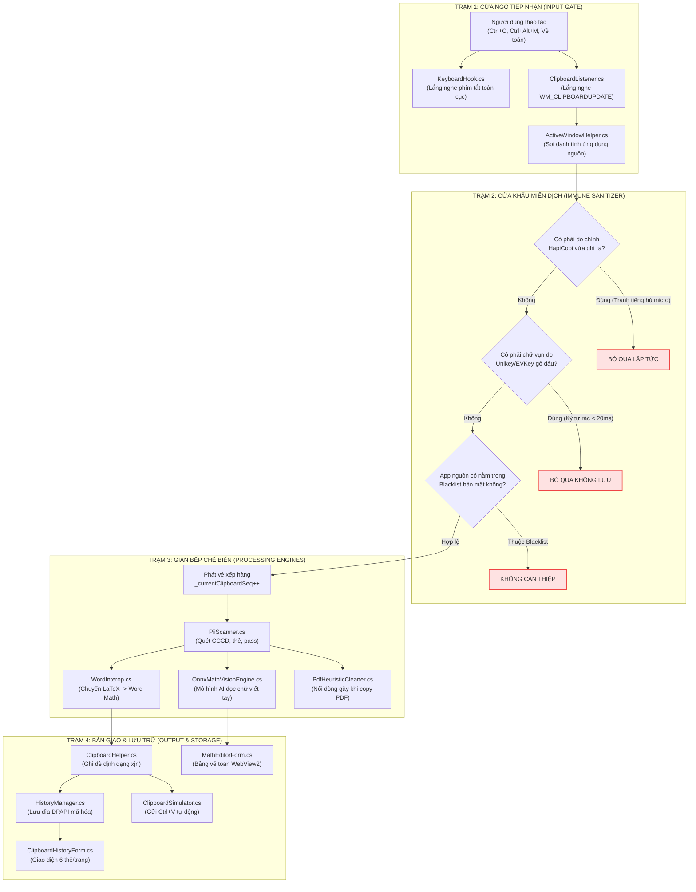

# BỨC TRANH TỔNG THỂ HỆ THỐNG & BẢN ĐỒ TỰ TÌM LỖ HỔNG (SYSTEM ARCHITECTURE & VULNERABILITY MAP)

> **Mục đích tài liệu:** Giúp bạn nhìn thấy toàn bộ "cơ thể sống" của HapiCopi trên một bức tranh duy nhất. Bạn sẽ thấy rõ từng bộ phận liên kết với nhau như thế nào, điểm yếu tử huyệt của từng bộ phận nằm ở đâu, và cách tự chẩn đoán bắt bệnh chỉ trong 3 giây khi có sự cố.

---

## 🗺️ I. BỨC TRANH TOÀN CẢNH: DÒNG CHẢY DỮ LIỆU CỦA HAPICOPI

Hãy hình dung dữ liệu từ lúc bạn nhấn phím cho đến khi công thức xuất hiện trên Word sẽ đi qua **4 Trạm kiểm soát** như sau:



---

## 🏛️ II. BẢN ĐỒ CHI TIẾT TỪNG THÀNH PHẦN: NHIỆM VỤ, TỬ HUYỆT & CÁCH PHÒNG THỦ

Hệ thống được chia làm **6 Bộ phận chủ chốt**. Mỗi bộ phận đều có **"Việc phải làm" (Operational)** và **"Lỗ hổng tiềm ẩn" (Vulnerability)**:

---

### BỘ PHẬN 1: TỔ LỄ TÂN & CỬA NGÕ (INPUT GATES)
*Nhiệm vụ: Canh gác ở tầng sâu nhất của Windows để nhận diện hành động của người dùng.*

| File mã nguồn | Nhiệm vụ chính (Làm việc) | Điểm yếu tử huyệt (Nơi dễ thủng) | Cơ chế phòng thủ đã/cần có |
|---|---|---|---|
| [`Core/KeyboardHook.cs`](file:///c:/Users/ThienNLH3/Desktop/Đại%20học%20FPT/Kỳ%208/EXE/HapiCopi/Core/KeyboardHook.cs) | Bắt phím tắt `Ctrl+Alt+M` mở Math Editor hoặc `Ctrl+Shift+V` mở Lịch sử. | **Bị Windows âm thầm ngắt phím (Unhook):** Nếu hàm xử lý mất $> 0.2\text{ s}$, Windows sẽ cắt đứt Hook mà không báo. | **Siêu tốc $< 0.5\text{ ms}$:** Đẩy ngay việc sang `Task.Run()`. Có timer kiểm tra "nhịp tim", nếu đứt tự động kết nối lại (`InstallHook`). |
| [`Core/ClipboardListener.cs`](file:///c:/Users/ThienNLH3/Desktop/Đại%20học%20FPT/Kỳ%208/EXE/HapiCopi/Core/ClipboardListener.cs) | Tạo cửa sổ ngầm lắng nghe sự kiện `WM_CLIPBOARDUPDATE`. | **Bị nghẽn Message Loop:** Nếu UI bị đơ, hàng đợi thông điệp của Windows sẽ bị ùn ứ, làm mất sự kiện copy. | Dùng cửa sổ chỉ nhận thông điệp (`HWND_MESSAGE`), giải phóng triệt để khi đóng app. |
| [`Core/ActiveWindowHelper.cs`](file:///c:/Users/ThienNLH3/Desktop/Đại%20học%20FPT/Kỳ%208/EXE/HapiCopi/Core/ActiveWindowHelper.cs) | Lấy tên ứng dụng bạn đang dùng (Word, Chrome, Visual Studio...). | **Lỗi quyền UIPI:** Nếu cửa sổ nguồn là Administrator (CMD Admin, Regedit), hàm Win32 có thể bị từ chối truy cập. | Bọc khối `try-catch`, nếu không lấy được quyền thì gán là `"Unknown"`, tuyệt đối không làm crash app. |

---

### BỘ PHẬN 2: CỬA KHẨU MIỄN DỊCH (IMMUNE SANITIZERS)
*Nhiệm vụ: Lọc sạch rác, dập tắt các phản xạ độc hại trước khi dữ liệu chui vào sâu trong app.*

| Điểm kiểm soát | Nhiệm vụ chính (Làm việc) | Điểm yếu tử huyệt (Nơi dễ thủng) | Cơ chế phòng thủ đã/cần có |
|---|---|---|---|
| **Chống tiếng hú micro (Re-entrancy Guard)** | Khi HapiCopi ghi đè clipboard, không được tự nhận lại dữ liệu của chính mình. | **Vòng lặp vô tận:** Ghi vào $\rightarrow$ Windows báo $\rightarrow$ Lại ghi vào $\rightarrow$ Tràn RAM, đơ máy. | Đặt cờ nguyên tử `_isSimulatingClipboard = true` trong suốt thời gian ghi; so sánh mã băm SHA-256 dữ liệu vừa xuất. |
| **Bộ lọc gõ tiếng Việt (IME Macro Filter)** | Phân biệt người dùng chủ động copy hay do Unikey/EVKey gõ dấu. | **Tràn rác lịch sử:** Unikey copy dán từng chữ `a, â, d, đ` khiến lịch sử clipboard bị chiếm kín bởi chữ rác. | Bỏ qua mọi chuỗi $\le 1$ ký tự nếu xuất hiện dồn dập ($< 20\text{ ms}$). |
| [`Core/ExclusionManager.cs`](file:///c:/Users/ThienNLH3/Desktop/Đại%20học%20FPT/Kỳ%208/EXE/HapiCopi/Core/ExclusionManager.cs) | Bỏ qua các ứng dụng trong danh sách loại trừ (như Password Manager 1Password, KeePass). | **Rò rỉ dữ liệu nhạy cảm:** Người dùng copy mật khẩu từ ví bảo mật nhưng HapiCopi vẫn vô tình lưu lại. | So khớp tên tiến trình với danh sách loại trừ ngay tại cửa ngõ trước khi đưa vào bộ nhớ. |

---

### BỘ PHẬN 3: GIAN BẾP CHẾ BIẾN (PROCESSING ENGINES)
*Nhiệm vụ: Phân tích, định dạng toán học, chạy AI nơ-ron và làm sạch nội dung.*

| File mã nguồn | Nhiệm vụ chính (Làm việc) | Điểm yếu tử huyệt (Nơi dễ thủng) | Cơ chế phòng thủ đã/cần có |
|---|---|---|---|
| **Bộ đếm thế hệ (`_currentClipboardSeq`)** | Cấp số thứ tự cho từng lần copy để quản lý các tác vụ bất đồng bộ. | **Đè kết quả cũ (Race Condition):** Copy mục A mất 300ms, copy mục B mất 5ms. Mục A xong sau đè mất mục B! | **Chiếc vé xếp hàng:** Khi tác vụ async hoàn thành, chỉ ghi kết quả nếu số vé của nó trùng với vé mới nhất hiện tại (`mySeq == _currentSeq`). |
| [`Core/WordInterop.cs`](file:///c:/Users/ThienNLH3/Desktop/Đại%20học%20FPT/Kỳ%208/EXE/HapiCopi/Core/WordInterop.cs) | Biên dịch công thức LaTeX/Markdown thành mã HTML/OMML để Word hiển thị đẹp. | **Lỗi cú pháp làm crash:** Công thức toán gõ sai cú pháp hoặc chứa thẻ HTML độc hại. | **Túi khí cứu sinh (Fail-Safe):** Bọc toàn bộ trong `try-catch`, nếu lỗi thì trả lại nguyên vẹn văn bản thô, không bao giờ xóa trắng clipboard. |
| [`Core/OnnxMathVisionEngine.cs`](file:///c:/Users/ThienNLH3/Desktop/Đại%20học%20FPT/Kỳ%208/EXE/HapiCopi/Core/OnnxMathVisionEngine.cs) | Chạy mạng nơ-ron ONNX nhận diện nét vẽ công thức toán offline. | **Lỗi tên thư mục tiếng Việt:** Nếu máy có tên `C:\Users\Nguyễn Văn A\...`, đường dẫn ANSI sẽ biến thành `Nguy?n V?n A` $\rightarrow$ Crash `FileNotFound`. | Nạp model bằng chuỗi Unicode UTF-16 chuẩn .NET (`string modelPath`). Không ép kiểu sang ANSI byte. |
| [`Core/HandwritingProfileService.cs`](file:///c:/Users/ThienNLH3/Desktop/Đại%20học%20FPT/Kỳ%208/EXE/HapiCopi/Core/HandwritingProfileService.cs) | Tự học nét viết riêng của bạn (Distillation, Repulsion). | **Xung đột đa luồng:** Vừa học nét mới vừa có luồng UI gọi nhận diện nét $\rightarrow$ Lỗi `Collection was modified`. | Bảo vệ danh sách mẫu nhận diện bằng `lock (_profileLock)` hoặc danh sách bất biến (Immutable). |

---

### BỘ PHẬN 4: KHO LƯU TRỮ & AN TOÀN (STORAGE & PERSISTENCE)
*Nhiệm vụ: Lưu lịch sử và cấu hình bảo mật trên ổ cứng của bạn.*

| File mã nguồn | Nhiệm vụ chính (Làm việc) | Điểm yếu tử huyệt (Nơi dễ thủng) | Cơ chế phòng thủ đã/cần có |
|---|---|---|---|
| [`Core/HistoryManager.cs`](file:///c:/Users/ThienNLH3/Desktop/Đại%20học%20FPT/Kỳ%208/EXE/HapiCopi/Core/HistoryManager.cs) | Lưu danh sách clipboard vào `history.dat`, mã hóa bằng Windows DPAPI. | **File bị trắng trơn (0 KB):** Đang ghi đĩa thì máy bị sập nguồn, đơ máy, hoặc 2 luồng cùng ghi đè một lúc. | **Ghi nguyên tử (Atomic Write):** Ghi ra file tạm `.tmp` trước, ghi xong xuôi mới đổi tên đè lên file chính (`File.Move(..., overwrite: true)`). |
| [`Core/ResourcePaths.cs`](file:///c:/Users/ThienNLH3/Desktop/Đại%20học%20FPT/Kỳ%208/EXE/HapiCopi/Core/ResourcePaths.cs) | Định vị đường dẫn các thư mục `%LOCALAPPDATA%`, `%APPDATA%`, `Logs`. | **Lỗi phân quyền UAC:** Nếu lưu vào `Program Files` sẽ bị Windows từ chối ghi khi không có quyền Admin. | Toàn bộ dữ liệu người dùng nằm 100% tại `%LOCALAPPDATA%\HapiCopi`, tuyệt đối không ghi vào Program Files. |

---

### BỘ PHẬN 5: MẶT TIỀN & TRẢI NGHIỆM GIAO HÀNG (UI & DELIVERY)
*Nhiệm vụ: Hiển thị các cửa sổ, bảng vẽ toán và thực hiện thao tác dán thông minh.*

| File mã nguồn | Nhiệm vụ chính (Làm việc) | Điểm yếu tử huyệt (Nơi dễ thủng) | Cơ chế phòng thủ đã/cần có |
|---|---|---|---|
| [`UI/ClipboardHistoryForm.cs`](file:///c:/Users/ThienNLH3/Desktop/Đại%20học%20FPT/Kỳ%208/EXE/HapiCopi/UI/ClipboardHistoryForm.cs) | Hiển thị bảng lịch sử để bạn chọn dán lại mục cũ. | **Chớp nháy trắng xóa & Lag:** Dùng cờ cũ `WS_EX_COMPOSITED` hoặc cuộn danh sách hàng ngàn dòng ngốn GDI. | Bỏ hoàn toàn `WS_EX_COMPOSITED`. Dùng **Phân trang 6 thẻ/trang**, lăn chuột là lật trang nhẹ nhàng trong 0.1ms. |
| [`UI/MathEditorForm.cs`](file:///c:/Users/ThienNLH3/Desktop/Đại%20học%20FPT/Kỳ%208/EXE/HapiCopi/UI/MathEditorForm.cs) | Cửa sổ bảng vẽ toán học. | **Nút bấm bị nhân đôi:** Bấm 1 lần chèn phân số nhảy ra 2 cái do ăn cả `mousedown` lẫn `click`. | Chỉ nhận `mousedown`, khóa an toàn Debounce 250ms tại hàm `handleFormulaInsert()`. |
| [`Core/WebViewManager.cs`](file:///c:/Users/ThienNLH3/Desktop/Đại%20học%20FPT/Kỳ%208/EXE/HapiCopi/Core/WebViewManager.cs) | Khởi tạo nhân Chromium WebView2 để vẽ bảng vẽ toán. | **Tiến trình ma & Thiếu Runtime:** Tắt app không dọn Edge con; máy cũ thiếu Edge Runtime bị văng app. | Đăng ký đóng sạch tiến trình con khi thoát (`Zero Ghost Process`); kiểm tra Registry trước khi nạp WebView2. |
| [`Core/ClipboardHelper.cs`](file:///c:/Users/ThienNLH3/Desktop/Đại%20học%20FPT/Kỳ%208/EXE/HapiCopi/Core/ClipboardHelper.cs) | Ghi dữ liệu đã format (HTML + Text + Ảnh) vào Clipboard. | **Lỗi STA Thread & Excel khóa:** Gọi Clipboard từ luồng ngầm gây crash, hoặc Excel đang giữ khóa Clipboard. | Ép chạy trên luồng STA (`SetApartmentState(ApartmentState.STA)`); bọc vòng lặp thử lại (Exponential Backoff). |

---

### BỘ PHẬN 6: BỘ CHỈ HUY & ĐIỀU PHỐI (ORCHESTRATOR & LIFECYCLE)
*Nhiệm vụ: Nhạc trưởng kết nối toàn bộ hệ thống từ lúc máy khởi động đến lúc tắt máy.*

| File mã nguồn | Nhiệm vụ chính (Làm việc) | Điểm yếu tử huyệt (Nơi dễ thủng) | Cơ chế phòng thủ đã/cần có |
|---|---|---|---|
| [`Program.cs`](file:///c:/Users/ThienNLH3/Desktop/Đại%20học%20FPT/Kỳ%208/EXE/HapiCopi/Program.cs) | Điểm bắt đầu của ứng dụng (Main Entry Point). | **Bật đè nhiều bản (Double Instance):** Người dùng bấm mở nhiều lần làm các bản đụng độ nhau. | Cài **Named Mutex** (`Global\HapiCopi_SingleInstance_Mutex_9912`), nếu thấy bản cũ thì gọi nó lên rồi bản mới tự tắt ngay. |
| [`UI/HapiCopiApplicationContext.cs`](file:///c:/Users/ThienNLH3/Desktop/Đại%20học%20FPT/Kỳ%208/EXE/HapiCopi/UI/HapiCopiApplicationContext.cs) | Trái tim của ứng dụng: quản lý icon khay, nhận sự kiện clipboard và điều phối toàn bộ luồng. | **Rò rỉ bộ nhớ & Bị Windows văng app:** Không thu gom RAM sau thời gian dài chạy ngầm; gặp lỗi lạ không bẫy. | Gọi `MemoryOptimizer.OptimizeMemory()` định kỳ; cài đặt lưới bẫy lỗi toàn cục (`Application.ThreadException`). |

---

## 🔍 III. MA TRẬN TỰ BẮT BỆNH: THẤY TRIỆU CHỨNG LÀ BIẾT NGAY THỦNG Ở ĐÂU!

Khi gặp bất kỳ hiện tượng lạ nào, bạn chỉ cần tra bảng này là biết ngay linh hồn của lỗi nằm ở file code nào:

```
                            BẢNG TRA CỨU TRIỆU CHỨNG NHANH
┌──────────────────────────────────────────────┬──────────────────────────┬─────────────────────────────┐
│ HIỆN TƯỢNG BẠN THẤY                          │ BỘ PHẬN BỊ THỦNG LỖ HỔNG │ FILE MÃ NGUỒN CẦN KIỂM TRA  │
├──────────────────────────────────────────────┼──────────────────────────┼─────────────────────────────┤
│ 1. Bấm phím tắt không mở được Math Editor    │ Sức khỏe Keyboard Hook   │ Core/KeyboardHook.cs        │
│ 2. Lịch sử clipboard đầy chữ cái vụn a, ư, d │ Bộ lọc gõ tiếng Việt     │ HapiCopiApplicationContext │
│ 3. Copy nhanh bị nhảy ngược về nội dung cũ   │ Bộ đếm vé xếp hàng       │ _currentClipboardSeq        │
│ 4. Bấm 1 lần chèn phân số nhảy ra 2 cái      │ Sự kiện chuột DOM lặp    │ WebViewResources/index.js   │
│ 5. Lăn chuột xem lịch sử bị chớp nháy trắng  │ Cờ vẽ đồ họa DWM cổ      │ UI/ClipboardHistoryForm.cs  │
│ 6. Máy tên tiếng Việt mở bảng vẽ bị lỗi      │ Mã hóa đường dẫn Unicode │ Core/ResourcePaths.cs       │
│ 7. Copy ở Excel làm app đơ 2-3 giây          │ Khóa Clipboard bận       │ Core/ClipboardHelper.cs     │
│ 8. Tắt app rồi Task Manager vẫn còn tiến trình│ Dọn dẹp cây tiến trình   │ Core/WebViewManager.cs      │
│ 9. Dán tự động vào cửa sổ Admin không ăn     │ Tường lửa bảo mật UIPI   │ Core/ClipboardSimulator.cs  │
│ 10. App biến mất đột ngột không lời từ biệt  │ Thiếu lưới bẫy ngoại lệ  │ Program.cs                  │
└──────────────────────────────────────────────┴──────────────────────────┴─────────────────────────────┘
```

---

## 💡 IV. QUY TẮC VÀNG ĐỂ BẠN TỰ RA QUYẾT ĐỊNH KỸ THUẬT

Khi bạn muốn thêm một tính năng mới hoặc sửa một lỗi, hãy luôn tự hỏi **3 câu hỏi kiểm tra lỗ hổng**:

1. **"Tính năng này có làm chậm luồng chính không?"**
   * Nếu có tác vụ I/O, mạng, hay AI $\rightarrow$ Bắt buộc tống sang luồng phụ (`Task.Run`), không bao giờ để đơ chuột người dùng.
2. **"Nếu người dùng thao tác siêu nhanh (spam click/copy) thì chuyện gì xảy ra?"**
   * Phải luôn có chốt bảo vệ: Debounce (khóa 250ms) hoặc Mã thế hệ (chỉ lấy kết quả mới nhất).
3. **"Nếu môi trường bên ngoài bị lỗi thì dữ liệu người dùng có an toàn không?"**
   * Nguyên tắc sống còn: Thà không format được chứ **tuyệt đối không bao giờ làm mất nội dung gốc của người dùng**!
